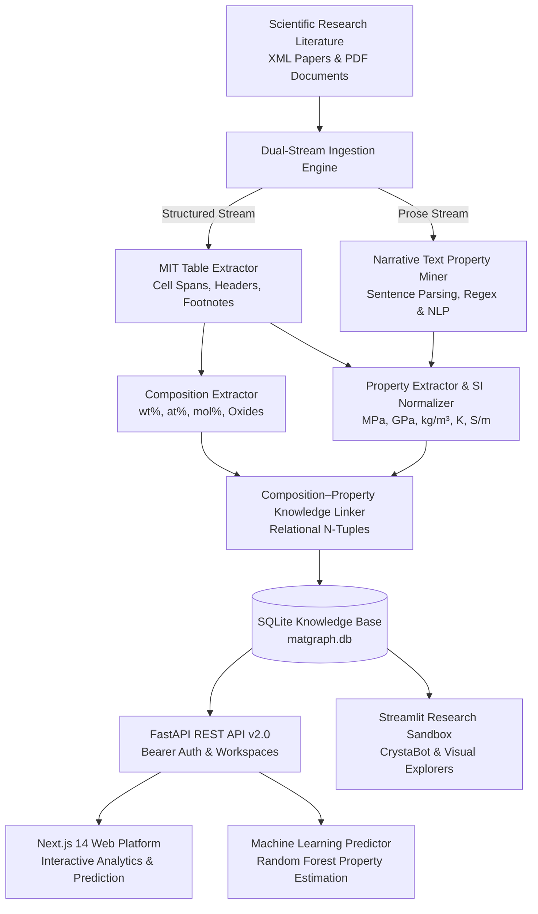

# 🔬 CrystaGraph: AI-Driven Materials Knowledge Mining Platform

[](https://www.python.org/)
[](https://fastapi.tiangolo.com/)
[-black.svg)](https://nextjs.org/)
[](https://streamlit.io/)
[](https://sqlite.org/)
[](LICENSE)
[]()

> **Autonomous Materials Informatics Platform for Extracting, Standardizing, and Synthesizing Chemical Compositions & Physical Properties from Scientific Research Literature.**

---

## 📌 1. Overview & Capabilities

Scientific materials informatics requires extracting structured property-composition relationships from published literature. However, over **80% of experimental composition percentages and physical properties are embedded inside tables and narrative paragraphs**, rather than structured databases.

**CrystaGraph** is an end-to-end multi-paper material knowledge mining, synthesis, and AI copilot platform. It:
1. **Parses Scientific Articles**: Handles standard Elsevier/JATS XML documents and PDF tables with cell span normalization (`morerows`, `namest`, `nameend`), preserving chemical notation ($SiO_2, Al_2O_3, Ti-6Al-4V$) and exponents.
2. **Mines Narrative Prose (No Tables Required)**: Automatically extracts material properties directly from abstracts, paragraphs, and experimental sections when tables are absent.
3. **Standardizes to Canonical SI Units**: Converts literature units ($g/cm^3 \rightarrow kg/m^3$, $^\circ C \rightarrow K$, $S/cm \rightarrow S/m$, $MPa/GPa$, $W/m\cdot K$) with interactive toggles.
4. **10-Paper Topic Synthesizer**: Consolidates materials across 10 research papers of the same topic into one unified comparative matrix and Ashby-style scatter plot.
5. **Conversational AI Copilot ("CrystaBot")**: Chat interface for material queries, cross-paper comparisons, live text property extraction, and ML predictions.
6. **Machine Learning Property Prediction**: Random Forest regression models to forecast properties for novel alloy formulations.
7. **Production REST Microservice & Next.js 14 UI**: High-throughput FastAPI backend with JWT academic authentication, custom collaborative workspaces, and a modern responsive Next.js web application.
8. **Daily Research Utilities**: Global Omnisearch (`⌘K` / `Ctrl+K`), quick SI unit converter drawer (`⌘U` / `Ctrl+U`), 1-click alloy presets, stoichiometry normalization (`Normalize to 100%`), and CSV/JSON dataset exports.

---

## 🏗️ 2. System Architecture



---

## 📁 3. Repository Directory Structure

```text
CrytaGraph Extractor/
├── frontend/                            # Next.js 14 Production Web Platform
│   ├── src/                             # React components & application pages
│   │   ├── app/                         # App router (dashboard, explorer, predict, workspaces)
│   │   └── components/                  # UI components, navigation, charts, modals
│   ├── public/                          # Static assets
│   ├── package.json                     # Frontend dependencies (Lucide, Tailwind, React 18)
│   └── Dockerfile                       # Containerized Next.js frontend build
├── app/                                 # Backend Services & Streamlit Sandbox
│   ├── api.py                           # High-performance FastAPI REST Microservice (v2.0)
│   ├── auth.py                          # Academic JWT authentication & password hashing
│   ├── pipeline_executor.py             # Paper upload & real-time extraction pipeline runner
│   ├── streamlit_app.py                 # Interactive Streamlit AI Copilot & Workstation
│   ├── components/                      # Streamlit UI modules (DB queries, charts, graphs)
│   └── pages/                           # Streamlit deep-dive research pages
│       ├── 1_📊_Dashboard.py            # High-level pipeline metrics
│       ├── 2_📄_Paper_Explorer.py       # Paper inspection & XML viewer
│       ├── 3_📋_Table_Explorer.py       # Raw vs cleaned table viewer
│       ├── 4_🔬_Material_Explorer.py    # Elemental stoichiometry & SI properties
│       ├── 5_🕸️_Knowledge_Graph.py      # NetworkX multi-relational graph
│       ├── 6_📈_Analytics.py            # Statistical distributions & correlations
│       ├── 7_⚙️_Processing_Pipeline.py  # Ingestion & live pipeline execution
│       ├── 8_🤖_AI_Property_Predictor.py# ML regression inference
│       └── 9_📑_PDF_Table_Miner.py      # PDF document table extractor
├── data/                                # Data Lake & SQLite Storage
│   ├── database/matgraph.db             # Relational SQLite database
│   ├── raw_xmls/                        # Benchmark scientific XML articles
│   ├── papers/                          # Ingested & uploaded academic papers
│   ├── tables/                          # Extracted table JSONs & CSVs
│   ├── extracted/                       # Extracted compositions & properties
│   └── processed/                       # ML tokenized splits & metrics
├── downloading_and_preprocessing/       # XML parsing & table extraction modules
│   ├── mit_table_extractor.py           # Core XML tree & table normalizer
│   ├── get_table_from_xmls.py           # Batch table extraction
│   └── pdf_table_extractor.py           # PDF miner integration
├── Matskraft_composition/               # Chemical composition extraction
│   ├── composition_extractor.py         # Elemental & oxide fractions
│   └── composition_rules.py             # Chemical formula validator
├── Matskraft_property/                  # Property extraction & SI standardization
│   ├── property_extractor.py            # Table property extractor
│   ├── text_property_extractor.py       # Narrative text property miner
│   ├── si_units.py                      # SI unit normalizer & conversion engine
│   └── property_vocab.py                # Domain taxonomy & synonyms
├── Linking_the_extracted_info_and_final_evaluation/
│   ├── linker.py                        # Composition-property associator
│   └── evaluator.py                     # Evaluation benchmark engine
├── models/                              # Machine learning prediction models
│   ├── train_property_predictor.py      # Random Forest property training
│   ├── model_*.joblib                   # Trained model weights (Yield Strength, Density, etc.)
│   └── predictor_metadata.json          # Model metadata & feature schema
├── scripts/                             # Automation & database utilities
│   ├── process_papers.py                # End-to-end pipeline execution
│   ├── build_database.py                # SQLite schema creation & population
│   └── migrate_v2_schema.py             # Schema migration for auth & workspaces
├── tests/                               # Automated unit test suite (21 tests)
│   ├── test_table_extraction.py
│   ├── test_preprocessing.py
│   ├── test_database.py
│   ├── test_api_and_ml.py
│   ├── test_text_and_si_extraction.py
│   ├── test_auth_and_workspace.py
│   └── test_upload_pipeline.py
├── start_platform.sh                    # One-command full-stack launcher (FastAPI + Next.js)
├── run.sh                               # Linux / macOS Streamlit launch script
├── run.bat                              # Windows Streamlit launch script
├── docker-compose.yml                   # Production multi-container Docker compose spec
├── Dockerfile                           # Backend Python containerfile
└── requirements.txt                     # Python dependencies (FastAPI, Streamlit, ML, etc.)
```

---

## 🚀 4. How to Run the Project (Updated v2.0 Guide)

### Prerequisites
- **Python**: 3.10 or higher
- **Node.js**: v18 or higher (with `npm`) for the Next.js frontend
- **Docker & Docker Compose** *(optional, for containerized run)*

---

### Step 1: Clone the Repository & Set Up Python Environment

```bash
# 1. Clone the repository
git clone https://github.com/ysahil2509/CrystaGraph.git
cd CrystaGraph

# 2. Create and activate a Python virtual environment
python3 -m venv venv
source venv/bin/activate    # On Windows: venv\Scripts\activate

# 3. Install Python dependencies
pip install -r requirements.txt
```

---

### Step 2: Install Frontend Dependencies

```bash
cd frontend
npm install
npm run build
cd ..
```

---

### Step 3: Launch the Application

Choose any of the following launch options based on your workflow:

#### Option A: One-Command Full-Stack Platform Launch (Recommended)
Automatically initializes the database, trains ML property models if needed, and starts both the **FastAPI backend** (port 8000) and **Next.js frontend** (port 3000):

```bash
chmod +x start_platform.sh  # Ensure executable permission
./start_platform.sh
```

| Service | URL | Description |
|---|---|---|
| **Next.js Web Application** | [http://localhost:3000](http://localhost:3000) | Full modern materials informatics web platform |
| **FastAPI REST API** | [http://localhost:8000](http://localhost:8000) | High-performance backend microservice |
| **Swagger Interactive Docs** | [http://localhost:8000/docs](http://localhost:8000/docs) | Complete OpenAPI documentation & testing sandbox |

*Press `Ctrl+C` to cleanly terminate both background services.*

---

#### Option B: Manual Multi-Terminal Launch (Development Mode)

If you are developing and need hot reloading on both services:

**Terminal 1 — FastAPI Backend:**
```bash
source venv/bin/activate
python3 -m uvicorn app.api:app --host 0.0.0.0 --port 8000 --reload
```

**Terminal 2 — Next.js Frontend:**
```bash
cd frontend
npm run dev
```

---

#### Option C: Docker Compose (Production Multi-Container)

Run the full stack containerized with a single command:

```bash
docker compose up --build
```

This spins up:
- `crystagraph-frontend`: Next.js 14 web app on [http://localhost:3000](http://localhost:3000)
- `crystagraph-api`: FastAPI REST service on [http://localhost:8000](http://localhost:8000)
- `crystagraph-streamlit`: Legacy Streamlit research sandbox on [http://localhost:8501](http://localhost:8501)

---

#### Option D: Streamlit Research Sandbox (Port 8501)

If you want to run the standalone Streamlit copilot and workstation:

```bash
# On Linux / macOS:
./run.sh

# On Windows:
run.bat

# Or directly via streamlit:
streamlit run app/streamlit_app.py
```
*Access the Streamlit platform at [http://localhost:8501](http://localhost:8501).*

---

## 🔌 5. REST API Endpoints Overview

The FastAPI backend exposes comprehensive endpoints documented at `http://localhost:8000/docs`:

- **Authentication & Profiles**:
  - `POST /api/auth/register` — Academic researcher registration
  - `POST /api/auth/login` — JWT Bearer authentication token retrieval
  - `GET /api/auth/me` — Authenticated profile verification
- **Knowledge Mining & Search**:
  - `GET /api/dashboard/stats` — Real-time material and property metrics
  - `GET /api/papers` — List ingested academic papers & metadata
  - `GET /api/search` — Unified keyword search across compositions and properties
  - `GET /api/matrix` — Cross-paper synthesized materials comparison matrix
  - `GET /api/units/convert` — Canonical SI unit conversion calculator
- **Workspaces & Collaboration**:
  - `GET /api/workspaces` — User research workspaces
  - `POST /api/workspaces` — Create new workspace project
  - `POST /api/workspaces/{id}/items` — Bookmark materials to workspace
- **Extraction Pipeline**:
  - `POST /api/papers/upload` — Upload scientific XML/PDF for real-time extraction
- **Machine Learning Inference**:
  - `POST /api/predict/properties` — Predict mechanical/functional properties from elemental compositions

---

## 🧪 6. Testing & Verification

Run the full automated test suite (21 unit test cases covering extraction, parsing, SQLite storage, ML models, SI conversions, auth, and workspaces):

```bash
python3 -m unittest discover tests
```

---

## 🌐 7. How to Deploy Online (Cloud Deployment Guide)

You can deploy CrystaGraph online using any of the following cloud hosting methods:

### Option 1: Vercel (Frontend) + Render / Railway (FastAPI Backend) — Recommended

This architecture separates the static Next.js edge frontend from the Python ML backend.

#### Step 1: Deploy FastAPI Backend on Render or Railway
1. Push your repository to GitHub.
2. Sign up / Log in to [Render](https://render.com/) or [Railway](https://railway.app/).
3. Click **New +** &rarr; **Web Service**, connect your GitHub repo `CrystaGraph`.
4. Configure the service settings:
   - **Environment**: `Python 3`
   - **Build Command**:
     ```bash
     pip install -r requirements.txt && python3 scripts/build_database.py && python3 scripts/process_papers.py && python3 models/train_property_predictor.py
     ```
   - **Start Command**:
     ```bash
     python3 -m uvicorn app.api:app --host 0.0.0.0 --port $PORT
     ```
   - **Environment Variables**:
     - `CRYSTAGRAPH_JWT_SECRET`: *(set a strong random secret key)*
5. Click **Deploy**. Note your live backend URL (e.g., `https://crystagraph-api.onrender.com`).

#### Step 2: Deploy Next.js Frontend on Vercel
1. Log in to [Vercel](https://vercel.com/) and click **Add New Project**.
2. Import your `CrystaGraph` repository.
3. In **Project Settings**:
   - **Root Directory**: `frontend`
   - **Framework Preset**: `Next.js`
   - **Environment Variables**:
     - `NEXT_PUBLIC_API_URL`: `https://crystagraph-api.onrender.com` *(your backend URL from Step 1)*
4. Click **Deploy**. Your frontend is live at `https://crystagraph.vercel.app`!

---

### Option 2: Full Docker Stack on VPS (AWS EC2 / DigitalOcean / Hetzner)

If you have a Linux server (Ubuntu/Debian) with Docker and Docker Compose installed:

```bash
# 1. SSH into your VPS server
ssh user@your-server-ip

# 2. Clone repository
git clone https://github.com/ysahil2509/CrystaGraph.git
cd CrystaGraph

# 3. Create .env file with your production secret
echo "JWT_SECRET_KEY=$(openssl rand -hex 32)" > .env

# 4. Launch all 3 containers in detached background mode
docker compose up -d --build
```

To expose with free SSL (HTTPS), set up Caddy or Nginx:
```caddyfile
# Caddyfile example:
yourdomain.com {
    reverse_proxy localhost:3000
}

api.yourdomain.com {
    reverse_proxy localhost:8000
}
```

---

### Option 3: Streamlit Community Cloud (Instant 1-Click for Sandbox)

To share the interactive research copilot and visual workstation publicly:

1. Fork or push this repository to GitHub.
2. Go to [share.streamlit.io](https://share.streamlit.io/) and log in with GitHub.
3. Click **New app**.
4. Select:
   - **Repository**: `your-username/CrystaGraph`
   - **Branch**: `main`
   - **Main file path**: `app/streamlit_app.py`
5. Click **Deploy!** Your interactive Streamlit app will be live within ~2 minutes.

---

## 📄 8. License
This project is open-source under the [MIT License](LICENSE).
