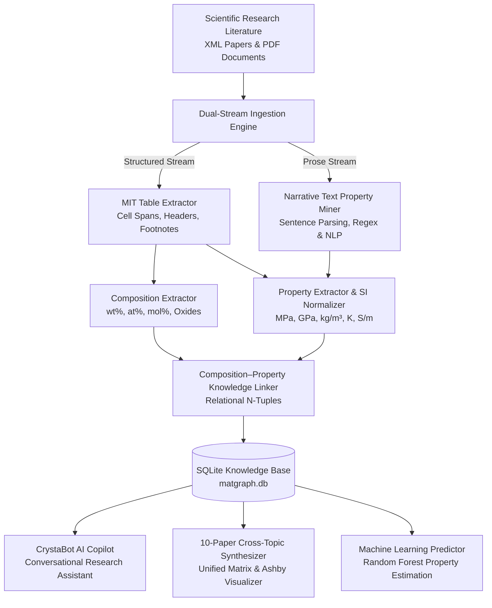

# 🔬 CrystaGraph: AI-Driven Materials Knowledge Mining Platform

[](https://www.python.org/)
[](https://streamlit.io/)
[](https://sqlite.org/)
[](LICENSE)
[]()

> **Autonomous Materials Informatics Platform for Extracting, Standardizing, and Synthesizing Chemical Compositions & Physical Properties from Scientific Research Literature.**

---

## 📌 1. Overview & Capabilities

Scientific materials informatics requires extracting structured property-composition relationships from published literature. However, over **80% of experimental composition percentages and physical properties are embedded inside tables and narrative paragraphs**, rather than structured databases.

**CrystaGraph** is an end-to-end multi-paper material knowledge mining, synthesis, and AI copilot platform. It:
1. **Parses Scientific Articles**: Handles standard Elsevier/JATS XML documents and PDF tables with cell span normalization (`morerows`, `namest`, `nameend`), preserving chemical notation ($SiO_2, Al_2O_3, Ti-6Al-4V$) and exponents.
2. **Mines Narrative Prose (No Tables Required)**: Automatically extracts material properties directly from abstracts, paragraphs, and experimental sections when tables are absent.
3. **Standardizes to Canonical SI Units**: Converts literature units ($g/cm^3 \rightarrow kg/m^3$, $^\circ C \rightarrow K$, $S/cm \rightarrow S/m$, $MPa/GPa$, $W/m\cdot K$) with interactive toggles.
4. **10-Paper Topic Synthesizer**: Consolidates materials across 10 research papers of the same topic into one unified comparative matrix and Ashby-style scatter plot.
5. **Conversational AI Copilot ("CrystaBot")**: Chat interface for material queries, cross-paper comparisons, live text property extraction, and ML predictions.
6. **Machine Learning Property Prediction**: Random Forest regression models to forecast properties for novel alloy formulations.

---

## 🏗️ 2. System Architecture



---

## 📁 3. Repository Directory Structure

```text
CrytaGraph Extractor/
├── app/                                 # Streamlit AI Web Application
│   ├── streamlit_app.py                 # Main entry point (CrystaBot & Workstation)
│   ├── api.py                           # RESTful FastAPI endpoints
│   ├── components/                      # UI modules (Database queries, Plotly charts, Graphs)
│   └── pages/                           # Deep-dive research pages
│       ├── 1_📊_Dashboard.py            # High-level pipeline metrics
│       ├── 2_📄_Paper_Explorer.py       # Paper inspection & XML viewer
│       ├── 3_📋_Table_Explorer.py       # Raw vs cleaned table viewer
│       ├── 4_🔬_Material_Explorer.py    # Elemental stoichiometry & SI properties
│       ├── 5_🕸️_Knowledge_Graph.py      # NetworkX multi-relational graph
│       ├── 6_📈_Analytics.py            # Statistical distributions & correlations
│       ├── 7_⚙️_Processing_Pipeline.py  # Ingestion & live pipeline execution
│       ├── 8_🤖_AI_Property_Predictor.py# ML regression inference
│       └── 9_📑_PDF_Table_Miner.py      # PDF document table extractor
├── data/                                # Data lake & SQLite storage
│   ├── database/matgraph.db             # Relational SQLite database
│   ├── raw_xmls/                        # Raw scientific XML articles
│   ├── tables/                          # Extracted table JSONs & CSVs
│   ├── extracted/                       # Extracted compositions & properties
│   └── processed/                       # ML tokenized splits & metrics
├── downloading_and_preprocessing/       # XML parsing & table extraction modules
│   ├── mit_table_extractor.py           # Core XML tree & table normalizer
│   ├── get_table_from_xmls.py           # Batch table extraction
│   └── pdf_table_extractor.py           # PDF miner integration
├── Matskraft_composition/               # Chemical composition extraction
│   ├── composition_extractor.py         # Elemental & oxide fractions
│   └── composition_rules.py             # Chemical formula validator
├── Matskraft_property/                  # Property extraction & SI standardization
│   ├── property_extractor.py            # Table property extractor
│   ├── text_property_extractor.py       # Narrative text property miner
│   ├── si_units.py                      # SI unit normalizer & conversion engine
│   └── property_vocab.py                # Domain taxonomy & synonyms
├── Linking_the_extracted_info_and_final_evaluation/
│   ├── linker.py                        # Composition-property associator
│   └── evaluator.py                     # Evaluation benchmark engine
├── models/                              # Machine learning prediction models
│   ├── train_property_predictor.py      # Random Forest property training
│   └── predictor_metadata.json          # Trained weights and feature schema
├── scripts/                             # Automation scripts
│   ├── process_papers.py                # End-to-end pipeline execution
│   └── build_database.py                # SQLite schema creation & population
├── tests/                               # Automated unit test suite
│   ├── test_table_extraction.py
│   ├── test_preprocessing.py
│   ├── test_database.py
│   ├── test_api_and_ml.py
│   └── test_text_and_si_extraction.py
├── requirements.txt                     # Python dependencies
├── run.sh                               # Linux / macOS launch script
└── run.bat                              # Windows launch script
```

---

## 🚀 4. Quick Start & Installation

### Prerequisites
- Python 3.10 or higher
- pip and virtualenv

### 1. Clone the Repository
```bash
git clone https://github.com/ysahil2509/CrystaGraph.git
cd CrystaGraph
```

### 2. Set Up Virtual Environment & Dependencies
```bash
python3 -m venv venv
source venv/bin/activate    # On Windows: venv\Scripts\activate
pip install -r requirements.txt
```

### 3. Run Pipeline & Launch Application
```bash
# Execute end-to-end extraction and database build
python3 scripts/process_papers.py

# Launch interactive Streamlit AI platform
streamlit run app/streamlit_app.py
```
*Access the platform in your browser at `http://localhost:8501`.*

---

## 🧪 5. Testing & Verification

Run the full automated test suite (13 unit test cases covering extraction, parsing, database queries, ML models, and SI conversions):

```bash
python3 -m unittest discover tests
```

---

## 📄 6. License
This project is open-source under the [MIT License](LICENSE).
