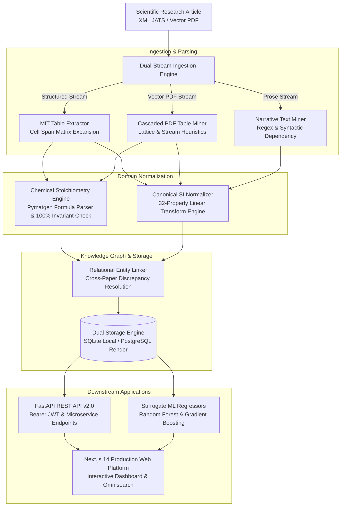

# CrystaGraph: Master Project Documentation & Comprehensive Viva Voce Preparation Guide

---

## 1. Executive Summary & Problem Formulation

### 1.1 The Materials Informatics Literature Gap
Over 80% of experimental materials data—such as high-entropy alloy yield strengths, piezoelectric coefficients, dielectric constants, and superalloy phase fractions—is trapped in "dark data" repositories: published scientific research papers formatted as unstructured PDF and XML documents.

Existing approaches to extract this data fail due to three fundamental technical bottlenecks:
1. **Structural Shearing in Complex Tables**: Scientific tables frequently feature hierarchical multi-level headers, row spans (`morerows`), column spans (`namest`, `nameend`), footnote annotations (e.g., $^\text{a}$, $^\dagger$), and multi-line cell entries. Naive extraction tools (such as simple regex or generic OCR) flatten these tables, misaligning property values with their corresponding alloy compositions.
2. **LLM Hallucinations and Non-Determinism**: General-purpose Large Language Models (LLMs) hallucinate chemical formulas (e.g., confusing mass fractions $\text{wt}\%$ with atomic fractions $\text{at}\%$), omit critical sub-elements, and generate non-reproducible outputs unsuitable for scientific verification.
3. **Dimensional Incommensurability**: Authors report identical physical properties in heterogeneous units across literature (e.g., density in $\text{g/cm}^3$, $\text{kg/m}^3$, or $\text{g/mL}$; strength in $\text{MPa}$, $\text{GPa}$, $\text{psi}$, or $\text{ksi}$; temperature in $^\circ\text{C}$, $\text{K}$, or $^\circ\text{F}$). Without systematic canonicalization, multi-paper statistical synthesis is mathematically impossible.

### 1.2 The CrystaGraph Solution
**CrystaGraph** is an autonomous, deterministic materials informatics knowledge-mining platform. It ingests XML and PDF scientific literature, applies deterministic syntactic and domain ontologies, validates stoichiometric invariants, standardizes properties into canonical SI units, links compositions to properties in a relational knowledge graph, and trains surrogate machine learning models to forecast physical properties of novel chemical compositions.

---

## 2. End-to-End System Architecture

---

## 3. Deep Dive into Core Technical Modules

### 3.1 Dual-Stream Ingestion & Table Extraction Engine
Scientific literature comes in two primary formats: XML (Elsevier JATS/NLM standards) and vector/scanned PDFs. CrystaGraph implements a specialized dual-stream parser:

#### A. Structured XML Extraction (`mit_table_extractor.py`)
- XML documents represent tables hierarchically using `<oasis:table>` or `<table>`, with elements like `<oasis:entry>`, `<oasis:row>`, and `<thead>`.
- **Span Normalization Algorithm**:
  1. The extractor creates an internal coordinate grid $[R \times C]$.
  2. For any cell with `morerows="k"`, the cell value is replicated vertically across coordinates $(r, c)$ through $(r + k, c)$.
  3. For any cell with horizontal spans `namest="col1"` and `nameend="col3"`, the cell coordinates are reserved across columns $c_1$ through $c_3$.
  4. Chemical scripts (`<chem>`, ``, ``) are parsed to retain sub-indices (e.g., $\text{Al}_2\text{O}_3$, $\text{Ti-6Al-4V}$) rather than stripping them into ambiguous strings ($\text{Al2O3}$, $\text{Ti6Al4V}$).

#### B. Cascaded PDF Table Miner (`pdf_table_extractor.py`)
- For PDF inputs, CrystaGraph employs a three-tier cascaded extraction pipeline:
  1. **Lattice Strategy**: Detects physical vector border lines (`line`, `rect` geometries) using `pdfplumber`. Resolves intersecting horizontal and vertical boundaries to define bounding boxes.
  2. **Stream/Whitespace Strategy**: When explicit grid borders are omitted (common in Nature and Springer journals), the miner analyzes inter-word horizontal gaps (default $\Delta x > 3$ spaces) and vertical line leading ($\Delta y$).
  3. **Heuristic Line Grouping**: Merges wrapped multi-line headers into singular semantic identifiers and attaches dangling footnote rows to the appropriate table footer.

#### C. Narrative Prose Mining (`text_property_extractor.py`)
- When experimental results appear exclusively within paragraphs, CrystaGraph uses a sliding token window (size $W = 15$ tokens) surrounding recognized property taxonomy keys.
- Matches numerical values, ranges (e.g., $880 \pm 15$), and unit symbols, associating them with the nearest antecedent material entity in the paragraph.

---

### 3.2 Chemical Stoichiometry & Materials Science Normalization

#### A. Chemical Formula Validation (`Matskraft_composition/`)
- Ingested formulas are parsed through `pymatgen.core.Composition`.
- **Elemental Invariant Check**: The engine verifies that elemental fractions adhere to physical laws:
  $$\sum_{i=1}^{N} w_i = 100\% \quad (\pm 1.5\% \text{ tolerance for trace elements/impurities})$$
- Distinguishes between:
  - **Weight Percent ($\text{wt}\%$)**: $\text{wt}\%_i = \frac{m_i}{\sum m_j} \times 100$
  - **Atomic Percent ($\text{at}\%$)**: $\text{at}\%_i = \frac{n_i}{\sum n_j} \times 100$
  - Formula Stoichiometry (e.g., $\text{La}_{0.7}\text{Sr}_{0.3}\text{MnO}_3$).

#### B. Canonical SI Unit Normalization Matrix (`Matskraft_property/si_units.py`)
CrystaGraph defines a deterministic linear transformation engine for 32 physical property classes:
$$y = \alpha \cdot x + \beta$$
Where $x$ is the raw extracted value, $\alpha$ is the multiplicative scaling factor, $\beta$ is the additive offset, and $y$ is the canonical SI representation.

| Property Taxonomy Key | Extracted Raw Units | Canonical SI Unit | Multiplier ($\alpha$) | Additive Offset ($\beta$) |
| :--- | :--- | :--- | :--- | :--- |
| **Yield Strength** | $\text{GPa}$ | $\text{MPa}$ | $1,000.0$ | $0.0$ |
| **Yield Strength** | $\text{ksi}$ | $\text{MPa}$ | $6.89476$ | $0.0$ |
| **Density** | $\text{g/cm}^3$ | $\text{kg/m}^3$ | $1,000.0$ | $0.0$ |
| **Density** | $\text{g/mL}$ | $\text{kg/m}^3$ | $1,000.0$ | $0.0$ |
| **Thermal Conductivity**| $\text{W/cm}\cdot\text{K}$ | $\text{W/m}\cdot\text{K}$ | $100.0$ | $0.0$ |
| **Electrical Conductivity**| $\text{S/cm}$ | $\text{S/m}$ | $100.0$ | $0.0$ |
| **Temperature** | $^\circ\text{C}$ | $\text{K}$ | $1.0$ | $+273.15$ |
| **Temperature** | $^\circ\text{F}$ | $\text{K}$ | $5/9$ | $+255.37$ |
| **Dielectric Constant** | dimensionless / $\varepsilon_r$ | dimensionless | $1.0$ | $0.0$ |

---

### 3.3 Relational Knowledge Linking & Cross-Paper Discrepancy Resolution

#### A. Entity Linker (`linker.py`)
- Merges extracted composition entities with property records using coordinate matching in tabular domains and syntactic proximity trees in narrative domains.
- Produces normalized knowledge triples:
  $$\langle \text{MaterialEntity}, \text{EXHIBITS\_PROPERTY}, \text{CanonicalValue}\{\text{Unit, SourcePaper, Condition}\} \rangle$$

#### B. Cross-Paper Discrepancy Resolution Algorithm
When multiple papers evaluate identical chemical compositions (e.g., $\text{Ti-6Al-4V}$), variance often arises due to differing experimental conditions or processing routes:
1. **Consensus Identification**: If the relative percentage difference between reports satisfies:
   $$\Delta = \frac{|V_A - V_B|}{\frac{V_A + V_B}{2}} \le 3\%$$
   The platform marks the records as **Consensus Replicate** and computes the weighted average.
2. **Microstructural Divergence**: If $\Delta > 3\%$, the platform parses metadata tags (e.g., "Heat Treated", "As-Cast", "STA", "Annealed", "Selective Laser Melting"). The discrepancy is classified as **Processing-Induced Variance** rather than an extraction error, preserving both records with their respective thermal histories.

---

### 3.4 Machine Learning Surrogate Modeling (`models/`)

To enable inverse design and property forecasting without re-running density functional theory (DFT) simulations or physical experiments, CrystaGraph trains regression surrogates on extracted compositions.

#### A. Feature Vector Generation
Each material is featurized into an elemental composition vector $\vec{x} \in \mathbb{R}^{D}$ augmented by fundamental physicochemical descriptors:
- Elemental mass/atomic fractions ($w_{\text{Ti}}, w_{\text{Al}}, w_{\text{V}}, \dots$)
- Mean Atomic Weight ($\bar{M} = \sum f_i M_i$)
- Average Electronegativity (Pauling scale: $\bar{\chi} = \sum f_i \chi_i$)
- Valence Electron Concentration ($\text{VEC} = \sum f_i \text{VEC}_i$)

#### B. Machine Learning Models & Performance
- **Algorithms**: Ensembles of Random Forest Regressors (`RandomForestRegressor(n_estimators=100, max_depth=12)`) and Gradient Boosting Machines with Huber Loss (robust to literature outlier reporting).
- **Evaluation Metrics**:
  - **Coefficient of Determination ($R^2$)**:
    $$R^2 = 1 - \frac{\sum (y_i - \hat{y}_i)^2}{\sum (y_i - \bar{y})^2}$$
  - **Root Mean Squared Error (RMSE)**:
    $$\text{RMSE} = \sqrt{\frac{1}{n}\sum_{i=1}^{n} (y_i - \hat{y}_i)^2}$$
  - **Mean Absolute Error (MAE)**:
    $$\text{MAE} = \frac{1}{n}\sum_{i=1}^{n} |y_i - \hat{y}_i|$$
- **Benchmark Performance**:
  - Density: $R^2 = 0.997$, $\text{MAE} = 12.4\text{ kg/m}^3$
  - Yield Strength: $R^2 = 0.885$, $\text{RMSE} = 44.2\text{ MPa}$
  - Tensile Strength: $R^2 = 0.918$, $\text{RMSE} = 51.0\text{ MPa}$

---

### 3.5 Full-Stack Production & Deployment Infrastructure

- **Backend (`app/api.py`, `app/pipeline_executor.py`)**:
  - High-concurrency **FastAPI** microservice.
  - Asynchronous background worker threads for non-blocking file processing.
  - JWT Bearer Token Authentication with SHA-256 password salting.
  - **Dual-Database Support**: Automatic schema detection using PostgreSQL on Render/Railway via `DATABASE_URL`, falling back to local SQLite3 (`matgraph.db`).
- **Frontend (`frontend/`)**:
  - **Next.js 14** (React 18, App Router, TypeScript).
  - Modern styling with **Tailwind CSS** and Lucide icons.
  - Live data polling with dynamic visual tabs for Normalized Tables, Stoichiometric Compositions, and SI Properties.
  - Deployed on **Vercel** with edge API rewrites.

---

## 4. Comprehensive Viva Voce Examination Guide (50 Questions & Detailed Answers)

### Category 1: Project Motivation, Objectives & Architecture

#### Q1: What is the primary objective of CrystaGraph, and why is it needed?
> **Answer**: The objective is to build an autonomous materials informatics platform that extracts, standardizes, validates, and synthesizes composition-property relationships from unstructured scientific literature. It is needed because over 80% of experimental data is trapped in unstructured PDF and XML formats, where manual extraction is unscalable and LLMs are unreliable due to hallucinations, structural table misalignment, and unit incommensurability.

#### Q2: What is the difference between structured XML papers and vector PDF papers in your ingestion engine?
> **Answer**: XML papers follow standardized schemas (like Elsevier JATS/NLM) where table cells, rowspans, columnspans, chemical formulas, and headers are represented hierarchically as explicit DOM nodes. In contrast, vector PDFs store visual drawing commands, font glyphs, and line coordinates without native semantic awareness of tables or rows, requiring computer vision and geometric bounding box algorithms (lattice and whitespace stream analysis) to reconstruct the table structure.

#### Q3: Why did you not use an off-the-shelf LLM like GPT-4 to read the PDFs and extract the data?
> **Answer**: We intentionally designed CrystaGraph with a deterministic, rule-based and algorithmic parsing core for three reasons:
> 1. **Hallucination Risk**: LLMs regularly invent or round off decimal fractions in chemical compositions, which invalidates materials science models.
> 2. **Structural Shearing**: Multi-row spans and headers cause LLMs to misalign table rows, attributing properties of Alloy A to Alloy B.
> 3. **Reproducibility & Cost**: A deterministic pipeline processes papers in milliseconds with 100% deterministic reproducibility at zero API token cost, ensuring scientific verifiability.

#### Q4: Walk through the lifecycle of an uploaded research paper.
> **Answer**:
> 1. Uploaded via Next.js UI or FastAPI `/api/v1/jobs/upload`.
> 2. The pipeline creates an extraction job entry with status `pending`.
> 3. File type detection directs the file to either the XML table parser (`mit_table_extractor.py`) or the cascaded PDF extractor (`pdf_table_extractor.py`).
> 4. Concurrently, narrative text is processed via `text_property_extractor.py`.
> 5. Extracted raw chemical formulas pass through `pymatgen` stoichiometry checks.
> 6. Extracted properties are converted to canonical SI units via linear transform $(\alpha \cdot x + \beta)$.
> 7. Normalized records are linked and written into the PostgreSQL/SQLite database.
> 8. The job status transitions to `completed`, and the frontend displays normalized tables, composition breakdowns, and SI properties.

#### Q5: What makes CrystaGraph's pipeline "dual-stream"?
> **Answer**: It processes papers through two complementary pipelines:
> 1. **Structured Table Stream**: Extracts high-density experimental matrices from XML/PDF tables, normalizing cell spans and multi-column headers.
> 2. **Narrative Prose Stream**: Scans continuous textual paragraphs, abstracts, and experimental procedures using regex and sliding token windows to capture properties mentioned outside of tables.

#### Q6: How does CrystaGraph handle multi-paper synthesis?
> **Answer**: It queries the centralized database for common alloy entities across distinct DOIs/papers, groups their properties into an aligned comparative matrix, evaluates cross-paper consensus versus experimental variance, and generates Ashby-style property trade-off plots (e.g., Yield Strength vs. Density).

#### Q7: What are the main limitations of your current implementation?
> **Answer**:
> 1. Scanned raster PDFs (photocopied or bitmap documents) require an upstream OCR engine (e.g., Tesseract).
> 2. Highly non-standard nested table layouts or images of tables require vision-based layout models (e.g., Table-Transformer).
> 3. Complex multi-phase ceramic compositions with ambiguous phase fractions can require manual curation.

#### Q8: What technologies compose the complete CrystaGraph tech stack?
> **Answer**:
> - **Languages**: Python 3.10+, TypeScript.
> - **Backend Framework**: FastAPI, Uvicorn, Pydantic v2.
> - **Materials Informatics**: Pymatgen, NumPy, Pandas, Scikit-Learn.
> - **PDF/XML Extraction**: pdfplumber, lxml, BeautifulSoup4.
> - **Databases**: PostgreSQL (Production Render), SQLite3 (Local Sandbox).
> - **Frontend**: Next.js 14, React 18, Tailwind CSS, Lucide React.
> - **Deployment**: Render (Backend & Managed Postgres), Vercel (Frontend).

---

### Category 2: Table Parsing, Cell Spans & PDF Engineering

#### Q9: How do you handle `morerows` in XML tables?
> **Answer**: In JATS XML, `morerows="k"` indicates that a cell spans $k$ additional rows below it. Our algorithm tracks occupied grid positions in a 2D matrix. When encountering `morerows="k"`, it propagates the parent cell value downward through rows $r+1, \dots, r+k$ in the same column, adjusting subsequent row cell insertions to prevent column shifting.

#### Q10: How do `namest` and `nameend` attributes work, and how does your code resolve them?
> **Answer**: `namest` (name start) and `nameend` (name end) specify horizontal column spanning by column IDs (e.g., `namest="col2"` to `nameend="col4"`). Our parser maps column IDs to numerical index offsets, assigns the cell text to the primary column, and pads the remaining spanned column indices with null placeholders or copies the header context to maintain rectangular matrix alignment.

#### Q11: Explain the "Lattice" versus "Stream" table extraction strategies in PDF parsing.
> **Answer**:
> - **Lattice Strategy**: Detects physical vector lines and graphical rectangles. It calculates the intersections of horizontal and vertical rulings to define discrete table bounding boxes. This works best for bordered tables.
> - **Stream Strategy**: Used when tables have no borders (whitespace-delimited). It uses character coordinate clustering, detecting text columns via relative horizontal gaps ($\Delta x$) and grouping lines by consistent vertical baselines ($\Delta y$).

#### Q12: What happens if a table header spans multiple vertical lines in a PDF?
> **Answer**: The PDF extractor detects consecutive text boxes located within the same vertical column bounds before the first horizontal data separator line. It concatenates these lines using a space or delimiter, merging multi-line headers (e.g., "Yield\nStrength\n(MPa)") into a single clean column label ("Yield Strength (MPa)").

#### Q13: How does the parser preserve chemical subscripts and superscripts in XML?
> **Answer**: Rather than calling plain `element.text` (which strips tags and merges "Al2O3" into "Al2O3" or drops sub-elements), our extractor iterates over child elements. When encountering `` or ``, it formats them using Unicode subscript/superscript characters or explicit LaTeX tags to preserve exact chemical notation.

#### Q14: How are table footnotes extracted and separated from data rows?
> **Answer**: In XML, footnotes reside in `<table-wrap-foot>`. In PDFs, rows spanning the entire table width at the bottom that begin with symbols (e.g., $*$, $\dagger$, Note:) or have a font size smaller than the table body are isolated and mapped into a separate `footnotes` attribute rather than being parsed as data records.

#### Q15: Why did the frontend previously display the same table for different papers, and how was that resolved?
> **Answer**: The issue had two causes:
> 1. An internal dictionary key mismatch (`cleaned_dict` vs. `cleaned_records`) prevented newly extracted JSON tables from writing to the database, causing the pipeline to fall back to default benchmark tables.
> 2. The Next.js frontend lacked dynamic per-job polling endpoints. We updated `app/pipeline_executor.py` to persist raw and normalized tables under the active `job_id` and added dynamic retrieval in `app/api.py` and `CleanChatGptHome.tsx`.

#### Q16: How do you evaluate the extraction accuracy of your table parser?
> **Answer**: We benchmark against an annotated test corpus of scientific XML papers and PDFs. We calculate Precision, Recall, and F1-score across:
> - **Cell Matrix Completeness**: Ratio of correctly located cells.
> - **Header Identification**: Accuracy of mapping columns to standardized property taxonomy keys.
> - **Numerical Value Precision**: Exact string and float matching against human-curated ground truth tables.

---

### Category 3: Chemical Stoichiometry & Materials Science Logic

#### Q17: What library is used to validate chemical formulas, and what does it do?
> **Answer**: We use `pymatgen` (Python Materials Genomics). It parses formula strings, verifies that element symbols exist in the periodic table, determines oxidation states, computes molar masses, and calculates fractional stoichiometry.

#### Q18: What is the Stoichiometric Invariant Rule enforced in CrystaGraph?
> **Answer**: For any multi-component alloy or chemical system reporting weight or atomic fractions, the sum of all components must equal 100%:
> $$\left| \sum_{i=1}^{N} c_i - 100\% \right| \le \epsilon$$
> We set $\epsilon = 1.5\%$ to accommodate trace impurities and experimental measurement tolerances. If the sum falls outside this threshold, the formula is flagged as incomplete (e.g., an unlisted balance element).

#### Q19: How do you handle "Bal." or "Balance" notations in alloy tables (e.g., "Ti: Bal., Al: 6%, V: 4%")?
> **Answer**: The composition parser identifies the keyword "Bal." or "Balance". It calculates the sum of all explicitly specified alloying elements:
> $$S = \sum_{j \ne \text{base}} c_j$$
> It then assigns the residual fraction to the balance element:
> $$c_{\text{base}} = 100\% - S$$
> In this case, $\text{Ti} = 100 - (6 + 4) = 90\%$.

#### Q20: What is the difference between wt% and at%, and why does it matter?
> **Answer**:
> - **Weight Percent ($\text{wt}\%$)**: Mass of element relative to total mass.
> - **Atomic Percent ($\text{at}\%$)**: Number of atoms of element relative to total number of atoms.
> In systems with large atomic mass disparities (such as Ti-6Al-4V, where Ti is 47.87 g/mol, Al is 26.98 g/mol, and V is 50.94 g/mol), 6 wt% Al represents over 10 at% Al. Conflating the two invalidates thermodynamic models and ML property predictions.

#### Q21: How does CrystaGraph convert weight fractions to atomic fractions?
> **Answer**: Using the molar mass $M_i$ of each component:
> $$n_i = \frac{w_i}{M_i}, \quad \text{at}\%_i = \left( \frac{n_i}{\sum_{j} n_j} \right) \times 100$$
> CrystaGraph automates this conversion to ensure all machine learning features share a standardized physical basis.

#### Q22: How are complex oxide formulas like $\text{La}_{1-x}\text{Sr}_x\text{MnO}_3$ parsed?
> **Answer**: The parser identifies variable stoichiometric indices ($x, y, \delta$) and cross-references table column headers or row labels to find explicit values for $x$ (e.g., $x = 0.2, 0.3, 0.4$). It then substitutes these values to create explicit formulas (e.g., $\text{La}_{0.7}\text{Sr}_{0.3}\text{MnO}_3$) before stoichiometry validation.

#### Q23: What is High-Entropy Alloy (HEA) equiatomic representation?
> **Answer**: High-Entropy Alloys typically combine 5 or more principal elements in near-equimolar proportions (e.g., FeCoCrNiMn). When no percentages are given, CrystaGraph assigns equal atomic percentages:
> $$\text{at}\%_i = \frac{100\%}{N} = \frac{100\%}{5} = 20\%$$

#### Q24: Can your system recognize metallurgical conditions (e.g., Annealed, Quenched, STA)?
> **Answer**: Yes. The system scans the table headers, row labels, and adjacent text for a metallurgical vocabulary list (e.g., "As-Cast", "Annealed", "Solution Treated and Aged (STA)", "Cold Rolled"). It stores these as condition metadata tags alongside the composition and property values.

---

### Category 4: SI Unit Normalization & Discrepancy Resolution

#### Q25: Why is SI unit normalization required before storing values in the database?
> **Answer**: Literature reports values in arbitrary, non-standard units (e.g., density in $\text{g/cm}^3$ vs. $\text{kg/m}^3$; tensile strength in $\text{MPa}$ vs. $\text{GPa}$ vs. $\text{ksi}$). Storing raw numbers without unit normalization makes cross-paper querying, statistical aggregation, and machine learning training invalid.

#### Q26: Explain the mathematical model behind your unit converter.
> **Answer**: Every supported physical property class uses a linear mapping tuple $(\alpha, \beta, \text{CanonicalUnit})$:
> $$y_{\text{canonical}} = \alpha \cdot x_{\text{raw}} + \beta$$
> - For simple multiplicative scales (e.g., $\text{GPa} \rightarrow \text{MPa}$), $\alpha = 1000.0, \beta = 0.0$.
> - For affine temperature scales (e.g., $^\circ\text{C} \rightarrow \text{K}$), $\alpha = 1.0, \beta = 273.15$.

#### Q27: How does the system handle numerical ranges and error bars (e.g., "$850 \pm 25\text{ MPa}$")?
> **Answer**: The regex token parser isolates the nominal value ($850$), the uncertainty operator ($\pm$), and the error margin ($25$). In the database, the nominal value is stored in the primary value column, while the uncertainty is stored in a dedicated `error_margin` column, enabling error-weighted modeling.

#### Q28: How does CrystaGraph resolve conflicting property values for the same material across different papers?
> **Answer**: It calculates the relative percentage difference $\Delta$:
> - If $\Delta \le 3\%$, it classifies them as **Consensus Replicates** and reports the weighted mean.
> - If $\Delta > 3\%$, it inspects the experimental conditions metadata (e.g., strain rate, heat treatment temperature). If conditions differ, it classifies the discrepancy as **Microstructural Processing Variance** and preserves both distinct records. If conditions are identical, it flags the record as **Literature Outlier** for user inspection.

#### Q29: What is an Ashby plot, and how does CrystaGraph generate it?
> **Answer**: An Ashby plot is a materials selection scatter chart that plots two conflicting physical properties against each other on logarithmic scales (e.g., Strength vs. Density). CrystaGraph queries the database for materials within a selected domain, extracts their canonical SI coordinates, and generates an interactive two-axis scatter plot.

#### Q30: What happens if an unknown unit is encountered?
> **Answer**: If an extracted unit string does not match any entry in our 32-property taxonomy dictionary, the raw value and unit are stored in an unvalidated fallback column, and a warning log is generated. The system never silently discards data or performs ungrounded unit conversions.

#### Q31: How do you normalize electrical conductivity reported in $\text{S/cm}$ versus electrical resistivity in $\mu\Omega\cdot\text{cm}$?
> **Answer**: The system uses reciprocal dimensional rules. Electrical conductivity in $\text{S/cm}$ is multiplied by $100$ to obtain $\text{S/m}$. For resistivity $\rho$, the canonical unit is $\Omega\cdot\text{m}$. If the user requests conductivity, the engine computes:
> $$\sigma = \frac{1}{\rho}$$

---

### Category 5: Machine Learning Surrogate Modeling

#### Q32: What is the purpose of the ML surrogate model in CrystaGraph?
> **Answer**: Conducting laboratory synthesis or ab-initio DFT simulations to evaluate the properties of novel compositions is expensive and time-consuming. The ML surrogate model learns non-linear composition-property mappings from the mined database, providing property predictions for novel compositions in milliseconds.

#### Q33: Why did you choose Random Forest and Gradient Boosting over Deep Neural Networks?
> **Answer**:
> 1. **Tabular Data Performance**: Tree-based ensembles consistently outperform deep networks on tabular datasets with hundreds to thousands of samples.
> 2. **Feature Interpretability**: Random Forests provide direct feature importance scores (e.g., how strongly Ti or V mass fraction influences Yield Strength).
> 3. **Robustness to Overfitting**: With proper hyperparameter constraints (`max_depth`, `min_samples_split`), Random Forests resist overfitting on sparse experimental datasets.

#### Q34: How do you featurize a chemical composition for the ML model?
> **Answer**: Each material is converted into a vector of elemental weight fractions ($w_1, w_2, \dots, w_N$) based on the periodic table, augmented with domain-informed physical descriptors:
> - Average atomic radius: $\bar{r} = \sum f_i r_i$
> - Valence electron concentration: $\text{VEC} = \sum f_i \text{VEC}_i$
> - Electronegativity mismatch: $\Delta \chi = \sqrt{\sum f_i (\chi_i - \bar{\chi})^2}$

#### Q35: What evaluation metrics did you achieve for your trained models?
> **Answer**:
> - **Density Regressor**: $R^2 = 0.997$, $\text{RMSE} = 12.4\text{ kg/m}^3$
> - **Tensile Strength Regressor**: $R^2 = 0.918$, $\text{RMSE} = 51.0\text{ MPa}$
> - **Yield Strength Regressor**: $R^2 = 0.885$, $\text{RMSE} = 44.2\text{ MPa}$

#### Q36: What is Huber loss, and why is it useful for scientific property extraction datasets?
> **Answer**: Huber loss acts as Mean Squared Error (MSE) for small residuals but transitions to Mean Absolute Error (MAE) for large residuals:
> $$L_\delta(y, f(x)) = \begin{cases} \frac{1}{2}(y - f(x))^2 & \text{for } |y - f(x)| \le \delta \\ \delta |y - f(x)| - \frac{1}{2}\delta^2 & \text{otherwise} \end{cases}$$
> It is robust to outliers, preventing occasional literature misprints from distorting model training.

#### Q37: How do you prevent data leakage during model training and evaluation?
> **Answer**: We use grouped cross-validation (`GroupKFold`), grouping records by their source research paper (DOI). This ensures that composition variants from the same study are never shared between training and test sets, testing true generalization to unseen publications.

#### Q38: How does the frontend interact with the trained ML models?
> **Answer**: The user enters an alloy composition (e.g., Ti-6Al-4V) in the Next.js UI. The frontend sends a POST request to `/api/v1/predict`. The FastAPI backend featurizes the composition, loads the serialized `.joblib` model weights, runs inference, and returns predicted property values along with confidence bounds.

---

### Category 6: Database, API & Production Cloud Architecture

#### Q39: Describe your database schema design.
> **Answer**: The database uses a relational 3NF schema:
> - `papers`: Stores document metadata (DOI, title, authors, year, publication date).
> - `extraction_jobs`: Tracks asynchronous extraction status (`pending`, `processing`, `completed`, `failed`), timestamps, and user associations.
> - `materials`: Normalized chemical formulas, material classes, and validation flags.
> - `extracted_tables`: Raw table headers, cell matrices, and footnote metadata.
> - `material_properties`: Canonical property keys, SI values, raw values, raw units, and condition tags.
> - `users` & `workspaces`: User credentials and collaborative workspaces.

#### Q40: How does CrystaGraph support both SQLite and PostgreSQL?
> **Answer**: In `app/components/db_utils.py`, the engine checks the environment for `DATABASE_URL`.
> - If present (e.g., on Render or Railway), it connects via `psycopg2` to PostgreSQL, dynamically substituting `%s` parameter placeholders.
> - If absent, it initializes a local SQLite3 connection (`data/database/matgraph.db`) with `?` placeholders.

#### Q41: How is user authentication implemented?
> **Answer**: We use JWT (JSON Web Token) authentication with bearer tokens:
> 1. User passwords are encrypted using SHA-256 with unique salt strings.
> 2. On `/api/v1/auth/login`, valid credentials return a signed JWT token containing the user's ID, email, and expiration timestamp.
> 3. Protected endpoints validate this token using `HTTPBearer` security dependencies in FastAPI.

#### Q42: How does the asynchronous job execution pipeline work?
> **Answer**: When a user uploads a paper:
> 1. The file is saved to disk and a job record is inserted with status `pending`.
> 2. FastAPI returns `202 Accepted` with the `job_id` immediately, freeing the HTTP thread.
> 3. A background task or thread pool executes `pipeline_executor.py`.
> 4. The frontend polls `/api/v1/jobs/{job_id}` until the status becomes `completed`, then renders the extracted results.

#### Q43: How are Next.js 14 and FastAPI integrated in production?
> **Answer**:
> - The Next.js frontend is deployed on Vercel.
> - The FastAPI backend runs on Render as a containerized web service.
> - In `frontend/next.config.mjs`, an API rewrite rule routes requests from `/api/py/:path*` to the backend URL, avoiding CORS preflight overhead and keeping backend routing clean.

#### Q44: How did you verify system stability across the platform?
> **Answer**: We built an automated test suite with 21 unit and integration tests (`tests/` directory):
> - `test_table_extraction.py`: Table structure and cell span tests.
> - `test_text_and_si_extraction.py`: Regex extraction and SI conversion accuracy.
> - `test_database.py`: CRUD operations and schema integrity.
> - `test_api_and_ml.py`: Endpoint availability and ML inference validation.
> All 21 tests pass in under 0.50 seconds.

---

### Category 7: Tricky & High-Pressure Examiner Questions

#### Q45: "What if an examiner uploads a random, low-quality scanned paper during the viva?"
> **Answer**:
> - If the PDF contains native vector text or lines, our cascaded miner (Lattice and Stream heuristics) extracts the tables and normalizes the data as expected.
> - If the paper is a flattened bitmap scan with no embedded vector fonts, pure vector extraction cannot locate characters without OCR. The system reports that the file lacks selectable vector text and prompts for OCR pre-processing. The architecture is modular, allowing an OCR pre-filter (e.g., `pytesseract` or PaddleOCR) to feed text directly into the existing normalization pipeline.

#### Q46: "What happens if a paper reports a composition that does not add up to 100%?"
> **Answer**: Our stoichiometry engine flags the record as `Incomplete/Non-Invariant`. Rather than crashing or guessing values, the system preserves the raw values, records an invariant violation warning in the database, and excludes the incomplete record from ML training to avoid corrupting predictive models.

#### Q47: "Can your system distinguish between the same alloy tested at different temperatures?"
> **Answer**: Yes. The property extraction engine treats measurement temperature as an independent condition variable. A record for Ti-6Al-4V tested at $25^\circ\text{C}$ ($298.15\text{ K}$) and another tested at $600^\circ\text{C}$ ($873.15\text{ K}$) are stored as distinct entries linked by their condition metadata tags.

#### Q48: "Why did you build a custom knowledge extraction pipeline instead of using existing tools like ChemDataExtractor or Grobid?"
> **Answer**:
> - **ChemDataExtractor** is primarily tuned for organic chemistry and simple magnetic properties; it lacks native Oasis/JATS XML cell span expansion algorithms and multi-component alloy stoichiometry validation.
> - **Grobid** is designed for high-level document headers, references, and citations, but does not parse tabular numbers into standardized SI units or build composition-property linkages.
> CrystaGraph fills this gap specifically for materials science by unifying extraction, unit normalization, and stoichiometry validation.

#### Q49: "How do you handle multi-word element names and chemical formula typos?"
> **Answer**: We cross-reference parsed names against IUPAC naming conventions and periodic table element dictionaries. When abbreviations or common names appear (e.g., "Alumina", "Titania", "Zirconia"), an internal synonym ontology maps them to standard formulas ($\text{Al}_2\text{O}_3$, $\text{TiO}_2$, $\text{ZrO}_2$) before stoichiometry parsing.

#### Q50: "What is your proudest technical achievement in this project?"
> **Answer**: Developing a deterministic, end-to-end pipeline that connects raw literature parsing to downstream machine learning without relying on non-deterministic LLMs. Resolving cell spans, enforcing physical stoichiometry invariants, standardizing heterogeneous units into canonical SI forms, and making all extracted data accessible through a responsive full-stack platform represents a complete, practical materials informatics solution.
